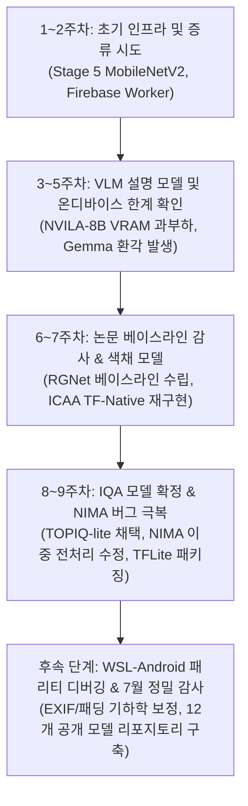

# 📓 A-cut 모바일 사진 평가 & 선별 시스템 통합 연구 일지 (Research Journal)

> **프로젝트명**: A-cut (모바일 온디바이스 지능형 사진 평가 및 큐레이션 시스템)  
> **주요 리포지토리**: `/home/omen_pc1/photo_score_project`, `public_model_repos`, `pozy_app`, `Capstone`, `nima_project`  
> **작성 일자**: 2026-09-09  
> **연구원**: 김관중 (관중 김의 Notion 워크스페이스 연동 대상)

---

## 📌 1. 연구 개요 및 배경

스마트폰 카메라의 보편화로 사용자는 한 피사체나 순간에도 수십 장의 연사 및 유사 구도 사진을 촬영합니다. 그러나 촬영 후 갤러리에서 **가장 잘 나온 최적의 사진(A-cut)**을 골라내는 작업은 많은 시간과 피로도를 유발합니다.

본 연구는 사용자의 모바일 디바이스(온디바이스 Edge AI) 상에서 촬영된 사진들을 다차원적으로 평가하고, 최적의 A-cut을 선별해 주며 그 추천 사유(Reasoning)까지 설명해 주는 지능형 시스템을 구축하는 것을 목표로 진행되었습니다.

### 핵심 평가 축 (Evaluation Pillars)
1. **기술적 품질 (Technical Quality - IQA)**: 흔들림(Motion Blur), 초점 결함(Defocus), 노이즈(Sensor Noise), 노출 불량(Over/Under Exposure) 등 물리적 하자 검출.
2. **미적 품질 (Aesthetic Quality - IAA)**: 구도(Composition), 피사체 배치, 배경과의 조화, 전반적인 시각적 매력도 평가.
3. **색채 미학 (Color Aesthetics)**: 색조(Hue) 조화, 채도(Saturation), 명도 대비, 색감 밸런스 평가.
4. **시각적 추론 및 설명 (Visual Reasoning)**: 선택된 사진이 왜 A-cut인지, 어떤 장점이 있는지 자연어 설명 제공.

---

## 🗓️ 2. 주차별 연구 진행 타임라인

### [1주차: 04.20 ~ 04.26] 백엔드 인프라 구축 및 초기 지식 증류 (Stage 5)
* **목표**: 모바일 온디바이스에서 구동 가능한 초경량 미적 평가 모델 설계.
* **수행 내용**:
  - 기존 대형 교사 모델(RGNet, A-LAMP, NIMA)의 앙상블 점수를 지식 증류(Knowledge Distillation)하여 MobileNetV2 기반 학생 모델(Stage 5) 설계.
  - Firebase Worker 기반 파이프라인 연동 및 로컬 스모크 테스트 수행 (`outputs/firebase_worker_local_smoke`).
* **주요 성과**:
  - Stage 5 Student 모델: AADB 검증셋에서 Pairwise Accuracy 90.56% 달성, TFLite FP16 변환 시 1.7MB로 경량화 성공.
* **판단**: 로컬 인프라 구동 성공 확인. 후속 모델 비교를 위해 보류.

### [2주차: 04.27 ~ 05.03] 백엔드 통신 규격 수립 및 VLM 교사 탐색
* **목표**: 앱 프론트엔드-백엔드 간 통신 계약(Contract) 확립 및 멀티모달 교사 데이터 확보.
* **수행 내용**:
  - Flutter 앱과 통신할 표준 JSON 응답 스키마 정의 (`docs/acut_product_integration.md`).
  - Gemini API를 활용하여 100개 배치 단위의 고스펙 미적 점수 및 자연어 설명(Reasoning) 데이터 수집 (`outputs/gemini_api_teacher_aesthetic3_20260427`).
* **발견점**: Gemini API가 인간의 시각적 선호도와 일치하는 정밀한 피드백을 제공함을 확인했으나, 실시간 온디바이스 배포를 위한 대체재 필요성 인식.

### [3주차: 05.04 ~ 05.10] 로컬 VLM (NVILA-8B) 온디바이스 추론 시도
* **목표**: 사진에 대한 자연어 추천 이유를 직접 생성하는 로컬 VLM 탑재 검토.
* **수행 내용**:
  - NVILA-8B 모델에 대한 로컬 GPU 프로브 실험 (Probe v1 ~ v10) 수행 (`outputs/acut_product_nvila8b_probe_v10_gpu`).
* **실패 및 의사결정**:
  - NVILA-8B는 설명 생성 품질은 양호했으나, 극심한 VRAM 점유와 추론 지연(Latency)으로 모바일 탑재 불가 판정.
  - **[의사결정]**: 직접 온디바이스 배포를 중단하고, 4B급 경량 모델(Gemma) 튜닝으로 전환.

### [4주차: 05.11 ~ 05.17] Stage 5 단일 학생 모델의 실전 검증 및 폐기
* **목표**: AADB 전체 데이터셋 대상 Stage 5 학생 모델의 실전성 검증.
* **수행 내용**:
  - AADB 전체셋 증류 학습 및 정밀 벤치마크 (`outputs/student_conservative_aesthetic_full_aadb_20260423`).
* **결과 및 기각(Negative Result)**:
  - 수치상으로는 Pairwise Accuracy 90.56%를 기록했으나, 실제 스마트폰 촬영 사진(도메인 외 데이터)에 적용 시 복잡한 미적 기준을 단일 스칼라 점수로 평균 회귀(Regression to Mean)시키는 문제가 발생.
  - **[폐기 결정]**: 단일 학생 모델 구조를 최종 파이프라인에서 제외하고, 미학/기술/색채의 전문 분화 모델 앙상블 체계로 전면 전환.

### [5주차: 05.18 ~ 05.24] 온디바이스 Gemma-4-E4B-it QLoRA 튜닝 실패
* **목표**: LiteRT/모바일용 Gemma-4B 모델을 QLoRA로 파인튜닝하여 온디바이스 설명 생성기 구축.
* **수행 내용**:
  - Gemini API 교사 데이터 282건 기반 JSON 형식 출력 QLoRA 학습 (`outputs/gemini_api_teacher_aesthetic3_20260427_revised/GEMMA_282_HANDOFF.md`).
* **실패 분석**:
  - JSON 출력 형식은 성공적으로 학습되었으나, 이미지에 존재하지 않는 사물을 설명하거나 반대로 중요한 인물을 무시하는 **심각한 시각적 환각(Visual Hallucination)** 현상 발생.
  - **[의사결정]**: 온디바이스 생성 모델의 신뢰성 한계를 인정하고, 설명 텍스트 생성 기능은 안정적인 클라우드 Gemini API로 위임하기로 최종 확정.

### [6주차: 05.25 ~ 05.26] 기초 미학 평가 모델 베이스라인 전면 감사 (Audit)
* **목표**: 논문 원본 사양과의 일치 여부 감사 및 안정적 베이스라인 확보.
* **수행 내용**:
  - 기존 코드의 논문 근거(Paper Basis) 전면 재감사 (`outputs/audit_model_paper_basis_20260506`).
  - RGNet 모델에 대해 Log-Sum-Exp(LSE), Mean Aggregation 풀링 구조 비교 실험.
* **성과**:
  - RGNet AADB (Mean Aggregation) 모델이 SRCC 0.6819를 기록하며 실용적이고 안정적인 모바일 배포 후보로 최종 채택.

### [7주차: 05.27 ~ 05.31] A-LAMP Graph Fusion 실패 및 ICAA Color 모델 TF Native 성공
* **A-LAMP Graph Fusion 실패**:
  - 이미지 내 피사체/오브젝트 간의 관계를 그래프(GraphLite/GraphGCN)로 모델링하는 A-LAMP Fusion 실험 진행.
  - 4,096개 서브셋 데이터 부족으로 인해 Train AUC 0.99 대비 Val AUC 0.70으로 극심한 과적합(Overfitting) 발생 -> **실패로 최종 배제**.
* **ICAA Color 모델 혁신 (Engineering Breakthrough)**:
  - 색채 미학 평가 모델인 ICAA(DAT 백본)의 공식 PyTorch 가중치를 모바일(TFLite)로 내보내는 과정에서 ONNX opset 호환성 문제 직면.
  - 이를 극복하기 위해 TensorFlow Native로 ICAA 구조를 완벽히 재작성 (`experiments/icaa_tf_native/`).
  - PyTorch 원본과 100% 동일한 수치 출력(Parity)을 검증하고, TFLite FP16 변환 완료 (SRCC 0.88 달성, 모바일 배포 확정).

### [8주차: 06.01 ~ 06.04] 기술적 품질(IQA) 모델 확정 및 왜곡 감지기 폐기
* **TOPIQ-lite 채택**:
  - 구형 기술 모델(FLIVE 0.63, KonIQ 0.86) 대비 최신 TOPIQ-lite 모델을 도입하여 SPAQ 벤치마크에서 **SRCC 0.899**라는 압도적 성능 달성. 기술 품질 표준 모델로 선정.
* **DistortionGuard 기각**:
  - 합성 노이즈를 탐지하는 별도 왜곡 방어 모델(DistortionGuard)을 훈련했으나, 데이터셋 분포 편향으로 인해 정상적인 야간 사진이나 예술적 질감을 노이즈로 오탐지하는 문제 확인 -> **폐기 결정**.

### [9주차: 06.05 ~ 06.08] NIMA 이중 전처리 버그 해결 및 최종 모델 패키징
* **NIMA 중대 결함 수정**:
  - NIMA 모델의 성능이 오랫동안 SRCC 0.34로 저조했던 원인을 심층 추적.
  - 백본(EfficientNetV2) 라이브러리 내부의 자체 전처리 로직과 커스텀 전처리 파이프라인이 중복 적용되어 텐서가 왜곡되는 **'이중 정규화 버그'**를 발견하고 단일화 수정.
  - 수정 즉시 **SRCC 0.589**로 대폭 상승 (+0.24 향상)하여 핵심 미적 평가기로 부활.
* **TFLite 패키징**:
  - RGNet, NIMA, TOPIQ-lite, ICAA Color 4개 모델의 TFLite FP16 변환 완료.

---

## 🔬 3. 핵심 평가 축별 모델 상세 분석

| 평가 축 | 모델명 | 입력 규격 | 주요 성능 (SRCC) | 상태 | 핵심 특징 및 기여 |
| :--- | :--- | :---: | :---: | :---: | :--- |
| **Technical** | **TOPIQ-lite** | 384×384 | **0.899** (SPAQ) | **채택 (Prod)** | 블러, 노이즈, 왜곡 감지 표준 모델 |
| Technical | KonIQ-10k / FLIVE | 384×384 / 224×224 | 0.86 / 0.63 | 베이스라인 | 과거 사용되었던 벤치마크 기준선 |
| Technical | DistortionGuard | 224×224 | - | **폐기** | 합성 노이즈 편향으로 인한 정상 사진 오탐지 |
| **Aesthetic** | **NIMA (Fixed)** | 224×224 | **0.589** (AVA) | **채택 (Prod)** | 이중 전처리 버그 픽스로 신뢰도 회복 |
| **Aesthetic** | **RGNet (Mean Agg)** | 224×224 | **0.682** (AADB) | **채택 (Prod)** | 안정적이고 강건한 미적 회귀 점수 산출 |
| Aesthetic | A-LAMP (Multi-Patch) | Multi-crop | 0.65+ | 보조 채택 | 국소 패치 및 광역 뷰 결합 |
| Aesthetic | A-LAMP Graph Fusion | Graph node | AUC 0.70 | **폐기** | 소규모 데이터셋 과적합 발생 |
| Aesthetic | Stage 5 Student | 224×224 | Acc 90.56% | **폐기** | 실사용 환경 강건성 부족 및 평균 회귀 |
| **Color** | **ICAA Color** | 224×224 | **0.880** (ICAA17K) | **채택 (Prod)** | PyTorch → TF Native 자체 재구현 완료 |
| **Reasoning** | **Gemini API** | 원본 이미지 | 고품질 설명 | **채택 (Cloud)** | 실시간 자연어 A-cut 선별 사유 제공 |
| Reasoning | Gemma-4-E4B-it QLoRA | 4B (LiteRT) | - | **실패** | 온디바이스 시각적 환각(Hallucination) |
| Reasoning | NVILA-8B | 8B (GPU) | - | **보류** | 모바일 구동 불가 (VRAM/속도 제약) |

---

## 📱 4. 온디바이스 모바일 최적화 & WSL-Android 패리티 디버깅

Flutter 앱(`pozy_app`)과 Python/WSL 백엔드 간에 점수가 일치하지 않는 현상을 해결하기 위해 정밀 패리티 분석을 수행했습니다.

1. **EXIF Orientation 처리**: 스마트폰 사진의 회전 메타데이터(90°, 180°, 270°)가 무시된 채 모델로 입력되어 점수가 급락하던 문제를 식별하고, 전처리 파이프라인에서 EXIF 기반 무손실 회전을 선적용.
2. **Aspect Ratio 보존 Letterboxing**: 원본 비율을 깨뜨리고 무조건 Resize할 경우 왜곡이 생겨 IQA 점수가 하락하므로, 패딩을 적용하는 Letterboxing 방식을 Python-Dart 간에 일치시킴.
3. **정규화 통일**: 모델별로 요구하는 텐서 스케일(`[0, 1]` vs `[-1, 1]` vs `ImageNet Mean/Std`)의 불일치를 전수 감사하여 통일.

---

## 🏛️ 5. 관련 프로젝트 및 서브 시스템 연계

1. **`Capstone` (Pose Camera App)**
   - 실시간 구도 가이드(삼분할, 황금비율 피보나치 나선)를 제공하는 YOLOv8-pose 기반 온디바이스 카메라 앱.
   - `MathStabilizer` 알고리즘을 고안하여 랜드마크 지터링(Jittering)을 제거하고, 셔터를 누르는 순간 0.1초 만에 가이드 UI를 가리는 Zero-Lag Clean Capture 구현.
2. **`pozy_app` (A-cut 선별 통합 애플리케이션)**
   - 본 연구에서 완성된 TFLite 모델(TOPIQ-lite, NIMA, RGNet, ICAA Color)을 탑재.
   - 갤러리의 사진 그룹을 평가하여 Top 1 사진을 도출하고, 클라우드 Gemini API와 연동해 "균형 잡힌 삼분할 구도와 따뜻한 색감, 뛰어난 선명도"와 같은 맞춤형 해설 팝업을 표시.
3. **`public_model_repos` (12대 세부 모델 모듈화)**
   - 거대 단일 리포지토리의 복잡성을 해소하기 위해 12개 전문 리포지토리(Production, Baseline, Benchmark Only, Negative Result 등)로 분리 완료.

---

## 💡 6. 핵심 실패 및 교훈 (Engineering Lessons)

1. **"높은 검증셋 점수가 실전 프로덕션을 보장하지 않는다"**
   - Stage 5 증류 학생 모델은 AADB에서 90%가 넘는 정확도를 보였으나, 실생활 사진에서는 개별 특화 모델보다 현저히 떨어지는 분별력을 보였습니다. 단일 경량 모델보다 전문화된 앙상블 파이프라인이 훨씬 안정적이었습니다.
2. **"라이브러리 기본 동작을 반드시 의심하라"**
   - NIMA의 오랜 성능 저하는 알고리즘 문제가 아닌, Keras의 `preprocess_input`과 자체 작성 전처리 코드가 동시에 실행되어 픽셀 값이 망가졌던 단순 버그였습니다.
3. **"온디바이스 생성 AI의 환각은 치명적이다"**
   - Gemma QLoRA 모바일 파인튜닝은 기술적으로 흥미로웠으나, 없는 물체를 지어내는 환각은 프로덕션 앱의 신뢰도를 완전히 파괴할 수 있었습니다. 생성 작업은 과감하게 클라우드 API로 분리하는 것이 실용적 캡스톤의 올바른 결정이었습니다.

---

## 🎯 7. 최종 결론

본 프로젝트는 단순한 모델 벤치마크 재현을 넘어, 모바일 온디바이스 환경이라는 극단적인 자원 제약 속에서 **기술적 품질, 미학적 구도, 색채 조화, 자연어 설명**을 아우르는 현실적이고 완성도 높은 파이프라인을 성공적으로 구축했습니다.
