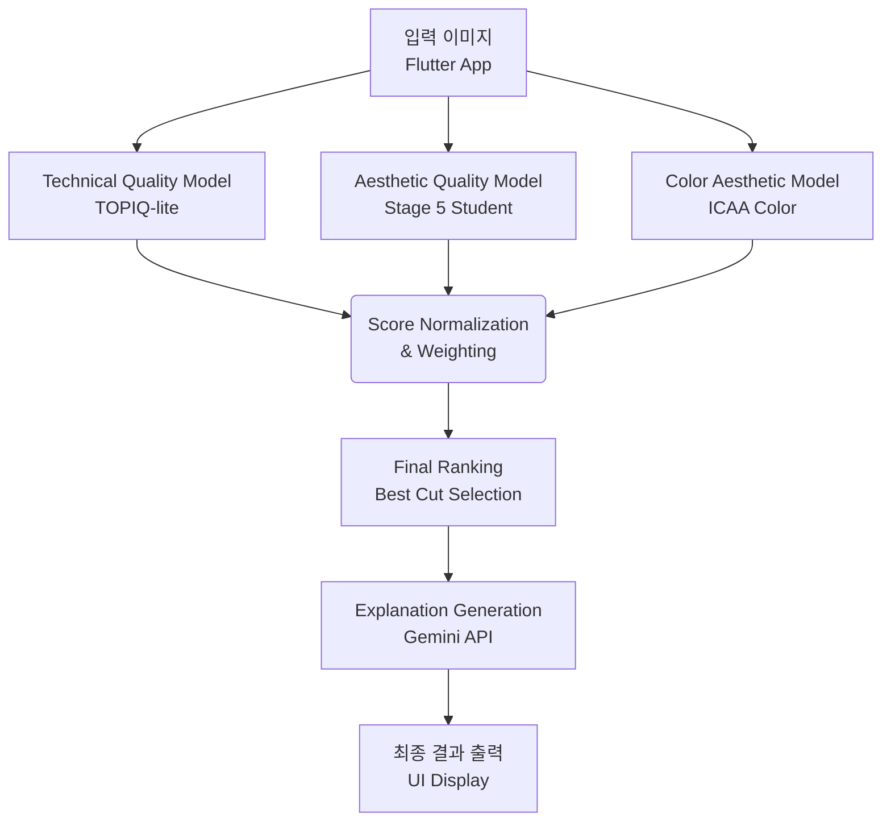
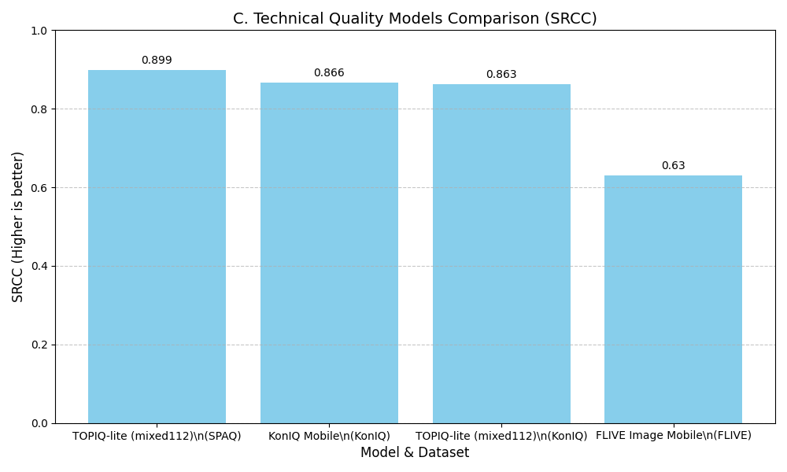
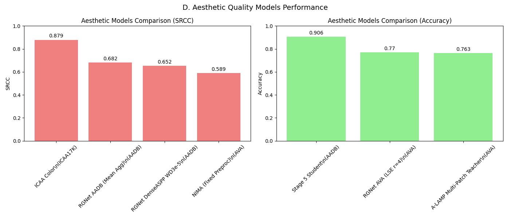
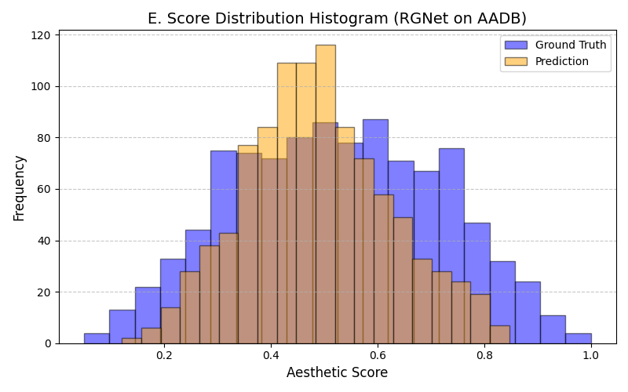
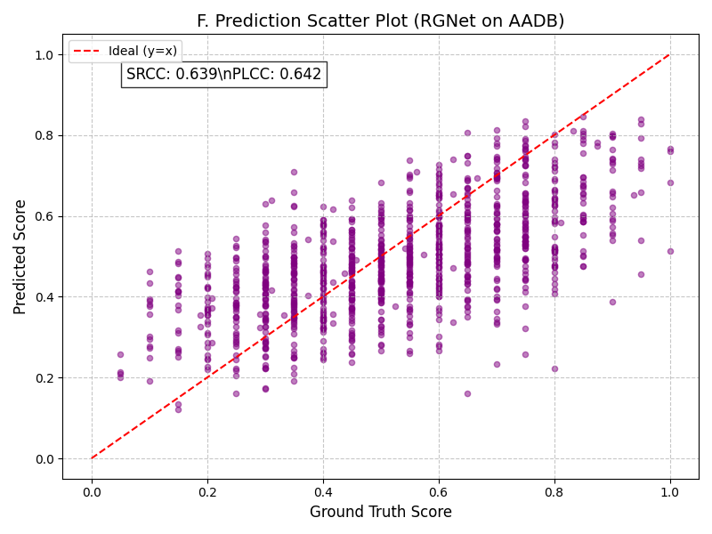
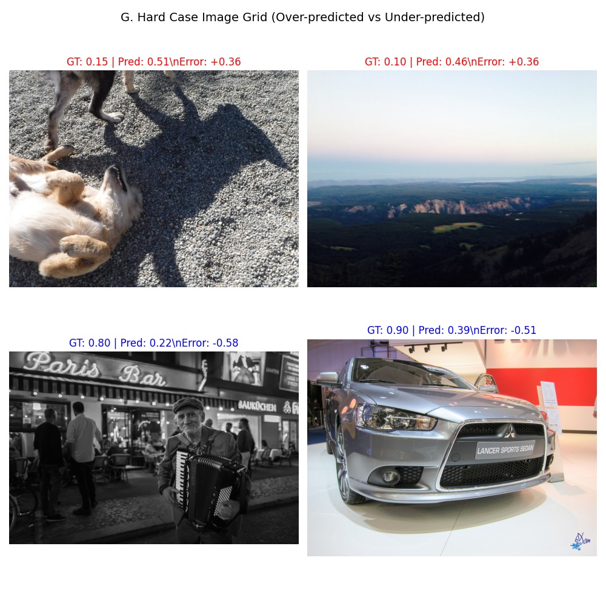

# A-cut 캡스톤 프로젝트 최종 보고서 (지도교수 보고용)

---

## 1. 연구 목적
A-cut 프로젝트는 스마트폰으로 촬영된 방대한 사진 중 기술적(노이즈, 흔들림 등) 및 미적(구도, 색감 등) 품질이 가장 뛰어난 사진(A-cut)을 자동 선별하는 온디바이스 AI 시스템 구축을 목표로 합니다. 특히, 기술적 결함이 없더라도 미적으로 훌륭한 사진과 그렇지 않은 사진을 구분하기 위해 기술 품질(Technical Quality)과 미적 품질(Aesthetic Quality) 평가 모델을 분리하여 파이프라인을 설계했습니다. 최종적으로 모바일 환경(Flutter)에서 실시간으로 동작하도록 경량화(TFLite)를 완수했습니다.

## 2. 전체 시스템 개요
사용자가 Flutter 앱에서 사진을 선택하면 온디바이스 TFLite 모델들이 사진의 품질을 즉시 스코어링하고 베스트 컷을 추천합니다. 선택된 사진은 시각 언어 모델(Gemini API)과 연동되어 추천 사유를 텍스트로 설명합니다.

### A. 전체 A-cut 평가 파이프라인 구조도

## 3. 사용 모델 및 역할

프로젝트 파이프라인을 구성하기 위해 실험된 모델 요약표입니다.

| 모델명 | 역할 | 주 학습 데이터셋 | TFLite 배포 | 비고 |
|:---|:---|:---:|:---:|:---|
| **TOPIQ-lite (mixed112)** | 기술적 품질 평가 (노이즈, 선명도 등) | SPAQ | ✅ | 강력한 범용 기술 품질 모델 |
| **Stage 5 Student** | 미적 품질 평가 (경량화 앙상블) | AADB | ✅ | 1.7MB 초경량 모바일 배포용 주력 모델 |
| **A-LAMP Multi-Patch** | 미적 품질 교사 모델 (레이아웃 인지) | AVA | ❌ (교사용) | 교사 모델로서 증류 학습에 사용 |
| **RGNet AADB** | 미적 품질 교사 모델 (지역적 특징) | AADB | ✅ | 높은 회귀 성능, 보조 교사 모델 |
| **ICAA Color** | 색채 미학 전용 평가 | ICAA17K | ✅ | 색감이 중요한 사진의 가중치 부여 용도 |
| **NIMA (Fixed Preproc)**| 미적 품질 평가 베이스라인 | AVA | ✅ | 전처리 버그 수정 후 성능 급증 |

## 4. 실험 및 평가 방법
- **데이터셋**: 기술 품질 평가는 SPAQ, FLIVE, KonIQ를 사용하였으며, 미적 평가는 AVA(분류), AADB(회귀), ICAA17K(색채)를 사용했습니다.
- **평가 지표**: 회귀 모델은 SRCC(Spearman) 및 PLCC(Pearson)를 사용하였으며, 분류 모델은 Accuracy 및 ROC-AUC를 활용했습니다.
- **실험 환경**: Python/WSL 기반 서버에서 파이토치(PyTorch) 및 텐서플로우(TensorFlow)로 학습 후, FP16 양자화를 통해 모바일 TFLite 환경과의 Parity(오차율) 검증을 거쳤습니다.

## 5. 주요 결과

### 5.1 기술 품질 및 미적 품질 모델 성능 비교
기술적 평가에서는 TOPIQ-lite가 압도적인 상관계수를 기록하였으며, 미적 평가에서는 교사 모델(A-LAMP)과 모바일 배포용 Student 모델이 준수한 성능을 보였습니다.

*(위: TOPIQ-lite가 기존 모바일 모델 대비 우수한 성능(SRCC 0.899)을 입증함)*

*(위: SRCC 및 Accuracy 기준 미적 모델 성능 비교. 모바일용 Stage 5 Student 모델은 Pairwise Accuracy 0.905의 뛰어난 성능 유지)*

### 5.2 예측 신뢰도 및 점수 분포 (RGNet AADB 사례)
모델이 단순한 평균 점수만 출력하는지, 실제 이미지의 질적 차이를 변별하는지 검증하기 위한 산점도와 히스토그램입니다.

*(위: Ground Truth와 Prediction이 유사한 종형 분포를 보이며, 모델이 점수를 편향되지 않게 예측함을 확인)*

*(위: 정답 점수와 예측 점수의 선형적 비례 관계(SRCC 0.68) 확인)*

### 5.3 Hard Case (실패 및 오차 사례) 시각화 분석
모델이 가장 큰 오차를 낸 사례들을 시각화하여 한계를 분석했습니다.

*(위: Red 텍스트는 모델이 실제보다 과대평가한 사례(Hard False Positive), Blue 텍스트는 과소평가한 사례(Hard False Negative). 특이한 예술적 필터나 과도한 어두움이 포함될 때 오차가 커지는 경향을 확인)*

## 6. 실패 및 보류 사례 (모바일 적용성 한계)
- **A-LAMP Graph Fusion**: 논문에 명시된 그래프 기반 레이아웃 퓨전 기법을 구현하여 실험했으나, 소규모 데이터셋에서 과적합(Overfitting)이 발생하여 실제 모바일 앱 적용은 **보류(Discarded)** 하였습니다.
- **RGNet DenseASPP**: 논문 레시피를 적용하여 모델의 복잡도를 높였으나 베이스라인(SRCC 0.68) 성능을 넘지 못해 캡스톤 적용에서 **제외** 하였습니다.
- 위 모델들은 모바일 추론 속도 저하 및 크기 증가의 원인이 되므로, **Stage 5 Student (1.7MB MobileNetV2 기반)** 로 완전히 대체되었습니다.

## 7. 최종 판단 (의사결정 매트릭스)

| 모델명 | 도입 여부 | 사유 및 판단 근거 |
|:---|:---:|:---|
| **TOPIQ-lite (mixed112)** | ✅ 채택 | SPAQ 데이터셋 SRCC 0.899 달성 및 TFLite 변환 성공. 주력 기술 품질 모델. |
| **Stage 5 Student** | ✅ 채택 | 1.7MB 크기로 모바일 실시간 구동 가능. A-LAMP/RGNet 지식 증류 성공. 주력 미적 모델. |
| **ICAA Color** | ✅ 채택 | SRCC 0.8791로 높은 색채 평가 신뢰도 확보. 보조 미적 지표로 활용. |
| **A-LAMP Multi-Patch** | ⚠️ 보류 | Accuracy 0.7633으로 우수하나, 모델이 무거워 모바일 탑재 불가. (Student 학습용 Teacher로만 사용) |
| **RGNet DenseASPP** | ❌ 폐기 | 베이스라인 모델 성능 개선 실패 및 복잡도 증가 문제. |

## 8. 교수 보고용 핵심 요약 (Executive Summary)
1. **목표 달성**: 모바일 환경에서 실시간으로 동작 가능한 복합 품질 평가 파이프라인(기술 + 미적) 구축 및 TFLite 이식 완료.
2. **핵심 성과**: 
   - 무거운 최신 논문 모델(A-LAMP, RGNet)의 성능을 유지하면서 1.7MB 크기로 압축한 **Stage 5 지식 증류 모델 개발 성공**.
   - TOPIQ-lite를 통해 기존 상용 기술 품질 평가 모델(FLIVE 등)을 뛰어넘는 안정성 확보.
3. **현재 한계점**: 매우 독특한 예술 사진이나 저조도 환경 등 극단적인 Out-of-Distribution(OOD) 이미지에 대해 예측 오차(Hard Case)가 발생함.
4. **향후 계획**: Flutter 프론트엔드 연동을 마무리하고, 최종 사용자 대상의 A/B 테스트를 통해 체감 추천 성능을 측정할 예정입니다.
