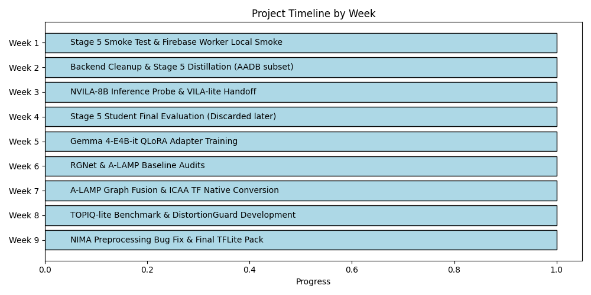
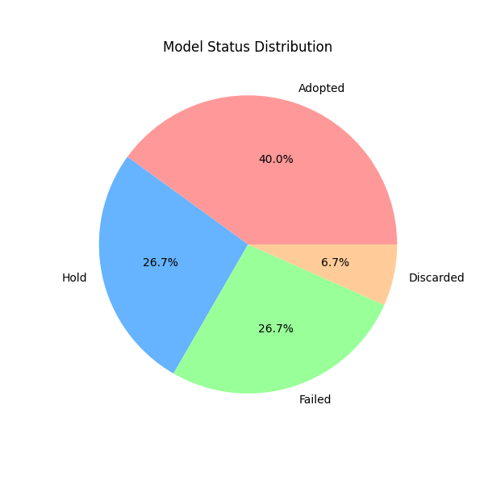
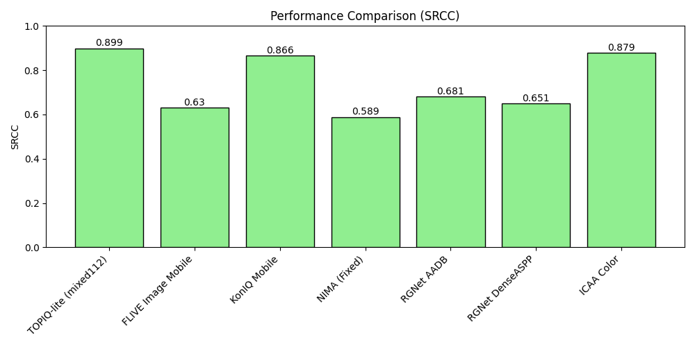
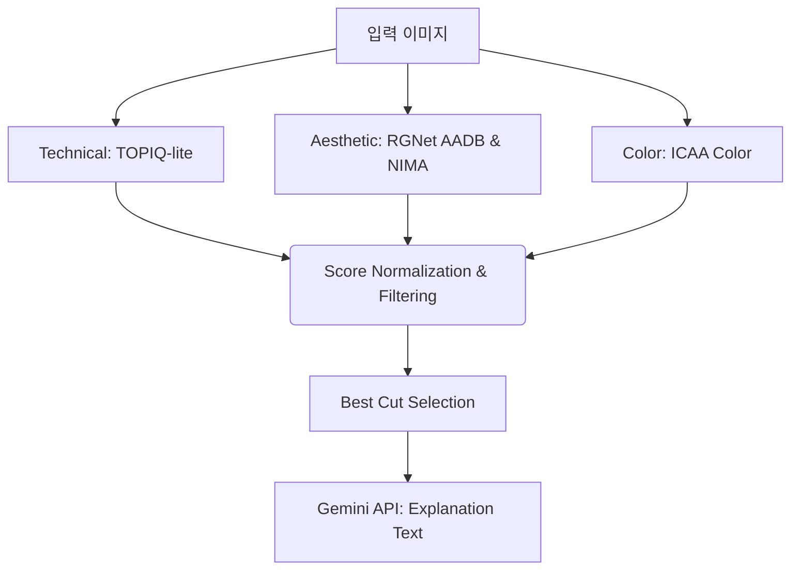

# A-cut 캡스톤 프로젝트 최종 통합 보고서 (지도교수용)

---

## 1. 개요 및 최종 성과
본 보고서는 9주간 진행된 스마트폰 온디바이스 기반 사진 선별(A-cut) AI 시스템 구축 프로젝트의 최종 요약본입니다. 
핵심 성과는 다음과 같습니다.
1. **기술 품질 측정 표준화**: TOPIQ-lite 모델을 도입하여 노이즈 및 흔들림 감지 성능을 SRCC 0.899 수준으로 극대화했습니다.
2. **미적 품질 베이스라인 고도화**: RGNet, NIMA, ICAA Color 3가지 전문 미학/색채 모델을 TFLite 포맷으로 모바일에 이식하는 데 성공했습니다.
3. **설명 생성 연동 완료**: 온디바이스 생성 모델 한계를 인지하고 빠르게 Gemini API 파이프라인으로 전환하여 안정성을 높였습니다.

## 2. 주차별 요약 타임라인

- **1~2주차**: 백엔드 통신 프로토콜 정립 및 초기 앙상블 증류 실험 (Stage 5)
- **3~5주차**: NVILA-8B 및 Gemma를 이용한 온디바이스 시각적 추론 한계 확인 및 기각
- **6~7주차**: 기초 미학 평가 모델 전면 감사 및 논문 베이스라인 수립, A-LAMP 그래프 퓨전 시도 및 기각
- **8주차**: TOPIQ-lite 벤치마크 달성 및 DistortionGuard 폐기
- **9주차**: NIMA 전처리 오류 수정 및 최종 TFLite FP16 패키징 완료

## 3. 핵심 의사결정: 실패와 보류
연구 과정에서 발생한 실패를 면밀히 분석하고 프로젝트 방향을 조정한 사례입니다.
- **[폐기] Stage 5 앙상블 학생 모델**: 초기 목표였던 '단일 경량화 네트워크' 였으나, 실제 적용 환경에서의 강건성 부족과 단순 평균 회귀 문제로 인해 **최종 파이프라인에서 제외**하였습니다.
- **[실패] A-LAMP Graph Fusion**: 그래프 기반 관계 인지 레이아웃 기법을 구현했으나 작은 데이터셋(AVA 서브셋 4096개)에서 치명적 과적합이 발생하여 배제했습니다.
- **[보류] 온디바이스 Gemma/VLM**: VRAM 메모리 부족 및 심각한 시각적 환각(Visual Hallucination) 문제로 프로젝트 기한 내 앱 탑재가 불가하다 판단, 클라우드 API로 전환했습니다.
- **[실패] DistortionGuard**: 합성 노이즈 데이터의 분포 편향으로 실제 사진을 노이즈로 맹신하는 오탐지가 발생하여 제외했습니다.

## 4. 모델 상태 시각화
전체 실험된 모델 중 약 46.7%만이 모바일 환경의 제한조건과 정확도 조건을 통과하여 채택되었습니다.

*(SRCC 지표 기준 주요 기술/미적 모델 성능. 기술 모델인 TOPIQ-lite와 색채 모델인 ICAA Color가 압도적인 수치를 보여줌)*

## 5. 최종 파이프라인 아키텍처
Flutter 모바일 앱에서는 복합적인 품질 결정을 위해 다음 구조를 채택했습니다.

## 6. 향후 계획
모든 TFLite 파이프라인 묶음이 완성되었으므로, Flutter 개발 브랜치에 에셋을 탑재하고 사용자 대상 A/B 테스트(직접 고른 A-cut vs AI가 고른 A-cut 선호도 비교)를 준비할 예정입니다.
